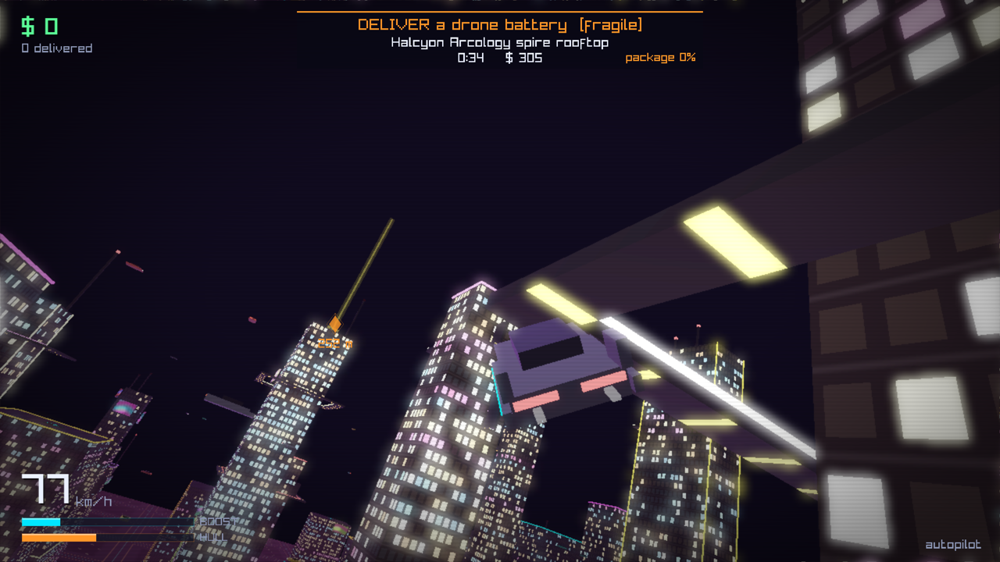

# Courier

Jobs by flying car through a night city, in slang on the raylib and
Jolt packages. The city is made from a seed and a level: blocks of towers
in tiers, with ledges, fins, billboards, halo platforms and antenna masts
sticking out of them, skybridges and glass tubes across the streets, and
traffic, thousands of cars, flying both ways along every street at six
heights, and more cars flying free of the lanes as you do. Offers wait on
pads around the city: deliveries, races, takedowns and tails. Fly to one
to take it.

## Jobs

The board holds four offers at a time (`game/missions.slang`), each on a
pad near you with a beacon in its color, an icon over it, its pay and the
time it stays up; offers run out and new ones come up in their place, and
while no job is under way a panel at the top lists them. Land on a
delivery or a race to take it; fly through the others.

- **Delivery** (cyan, a package): the package is taken at the offer's
  pad, to be landed on another pad before the clock runs out. Pay comes
  from the distance, the time left and the package in one piece.
- **Race** (green, a chequered flag): a rival courier waits over the pad;
  after a count of three (you are held still for it) you race it to a pad
  far off. Land there first. The rival is the autopilot, more aggressive
  in each district.
- **Takedown** (red, a crosshair): a red car flees through the city; ram
  it until it goes down, before the time is up. A harder ram takes more,
  and a rammed car spins out a moment and flies slower after.
- **Tail** (violet, an eye): a violet car flies calmly to a pad of its
  own; follow it there. Nearer than 20 m too long and it spots you;
  further than 140 m too long and you have lost it.

Every job done counts toward the next district.

```sh
make courier           # or: slang run examples/courier/main.slang
make courier-test      # the city, the car, the traffic and the jobs, without a window
```



## Flying

The mouse steers: moving it pushes a reticle away from the middle of the
screen, and the car turns toward the reticle, pitching and banking into
the turn; let the mouse rest and the reticle drifts back, and the car
levels itself. `W` is thrust, `S` brake and reverse, `Space` or the left
button boost. The full set is there for whoever wants it: `A`/`D` roll,
`Q`/`E` yaw, the arrow keys pitch and roll. A gamepad works too: left
stick pitch and roll, right stick yaw, triggers thrust and brake, A boost,
X jump.

The magnet is always on. Come near a wall, a roof, the underside of a
bridge or the ground gently or at a glancing angle, and the car is pulled
onto the surface and drives along it as if that were the ground: steer
with yaw or roll, thrust and brake as before, and the camera rolls with
you, so a wall becomes a road and the street a cliff. Hit it head-on at
speed and it is a crash instead, unless you come at it belly first: roll
or pitch the car's underside to the wall and the magnet takes it at any
speed, the speed into the wall gone at once in a slam, no damage done. Drive off the edge and you fly again, or
press `F` (or the right button) to jump off; in the air the same button
keeps the magnet from grabbing for a moment, to pass close by a wall.

**Slots** are where the magnet pays. In a few rows of blocks (more in the
busier districts) each block is split by a gap 2 m wide, lit amber at its
mouths and along its top: too narrow to fly through level (the car is
2.2 m wide), just right on its side riding one of its walls, since the
magnet holds the car 1 m off the wall, in the middle. The two towers are
staggered, so whichever way you come, one wall starts 18 m before the gap
closes: fly in alongside it and the magnet takes you flat onto it and
into the slot (a slot's walls grip harder than others). In a slot, with
the stick let go, the car runs level along it like a rail, with a third
more thrust; out of the far end it keeps its attitude for a moment
(unless you steer), so it crosses the street on its side straight into
the next slot of the line, which is aligned with it. Each slot threaded
end to end counts as a near miss (THREAD) in the chain. At either end of
a line (unless it runs to the city's edge) is a block split wider, 10 m,
lit amber at its four mouths: on the way in, fly level down its middle
and you come out beside the first slot's lead wall, near enough for the
magnet to take you; on the way out, you fly on off the last wall through
it into the open street. Its walls do not hold the magnet (riding one
would lead into the end of a slot's tower).

The sky is not a way around the traffic: a little over the tallest
building the car is pulled back down, harder the higher it gets (the
boost buys some more height, not much).

Speed is the point, and the question is always how much of it you can
afford:

- **Boost** burns a meter. It refills slowly by itself, fast when you
  **skim** a surface at speed (within a few meters, a wall, a roof or a
  bridge) or ride one with the magnet, and in a jump for every **near
  miss** with traffic. Flying close to things is how you go faster.
- **Near misses** are graded by the air left between the hulls at the
  closest point of the pass: CLOSE (under 4 m), TIGHT (under 1.6 m) and
  RAZOR (under 0.6 m), worth more the faster the pass and half again for
  an oncoming car; a pass that touches is worth nothing. Misses
  **chain**: each one winds the chain's clock back to 3.5 s and raises
  the multiplier (+0.25 each, up to x3), and skimming a wall holds the
  clock. When the clock runs out the chain's cash is banked; a hit before
  that loses all of it. The tuning is at the top of `game/near_miss.slang`.
- **Hits** cost hull by how hard you hit (anything above a scratch), knock
  the boost meter down, send the other car spinning out of its lane, and
  bruise a package you carry, which pays less; fragile packages bruise
  twice as fast and pay more.
- The hull gone, the car is **wrecked**: the job is lost, the fine is $50,
  and you start again at the last pad.
- The pad wants you **slow**: under 65 km/h within seven meters, so every
  run ends in braking you have to time.
- A delivery's clock runs from the moment it is taken; a **late**
  delivery pays a third. `R` takes you back to the last pad for $20 when you are
  lost.

## Districts

The game has levels, the districts of `game/levels.slang`. You start in
the **Outskirts**: a wide grid of low, plain towers with few bridges,
wide streets, a few slow cars in three lanes of height, and a generous
clock. Three jobs move you to **Midtown**, then **Downtown**
(the city of the screenshot), then **The Core**: tall towers with
everything hanging off them, bridges and tubes everywhere, seven heights
of traffic with three fast lanes side by side in each direction, and a
clock that assumes you fly fast. Past the Core the city comes back faster
each time. Credits and the count of jobs carry over; the hull is
new. Each district is a table of numbers: the grid, the street width, the
heights, how much sticks out of the towers, the bridges, the lane heights
and offsets (three lanes each way in the Core), the cars and their
speeds, the time budget and the jobs needed. The title screen is the menu: choose a district with
the arrow keys or the mouse and press Enter (or click) to start there;
`COURIER_LEVEL=n` picks district n from the start.

## How it is built

- `game/city.slang`: the generator. Everything solid is a box with a
  kind (facade, neon, structure, billboard, pad, ground, roof) in a
  spatial grid; some are solids, convex shapes between a polygon at the
  bottom and one at the top inside their box's bounds: towers with their
  corners cut, sloped skirts between tiers, pyramids, spires, sheds,
  gables, domes and stepped crowns on the roofs, the corners of holes.
  The physics has their convex hulls and the magnet their planes, so a
  slope can be ridden; the grid, the routes and the pads keep to the
  bounds. Some tiers have a hole through them to fly through (a
  rectangle, an arch, an octagon, a diamond, a slit to take on edge, or
  two side by side), lit round its mouths; ribs and bands on the walls
  are only drawn. How often each comes up is `STYLE` at the top of the
  section; the style draws from a generator of its own, so the layout
  of a seed stays the same. Towers are stacks of inset tiers, decorated per tier;
  bridges span neighbouring blocks at heights between the traffic lanes
  (open slabs with rails, or tubes with lit walls to fly through); pads
  are placed last, only where the air above them is clear.
- `game/car.slang`: the car is a Jolt rigid body. Thrust, drag (little
  forward, a lot sideways, less of it the faster it goes, so it drifts),
  the turning rates and the self-leveling are forces and torques; the
  magnet is a spring to the surface and a torque to its normal. Jolt
  resolves the collisions, and its contact reports become hits.
- `game/designs.slang`: what the cars look like: thirteen traffic
  designs in five size classes (compact pods, saloons, coupes, taxis,
  patrol cars, vans, limousines, buses, freighters, tankers), each class
  its own physics box, and four for the cars flying free (the courier,
  a dart, an interceptor, a skiff). A design is lofts, boxes and lights
  in the car's frame, its colors fixed or slots the palette fills.
- `game/traffic.slang`: thousands of cars, and nothing is stepped. Every
  lane is a conveyor: its cars share its speed and keep their order, so a
  car's place is a formula of the time (start plus speed times time,
  wrapped at the city's edge). The renderer draws each design once,
  instanced, every car's lane, start, speed and colors in its instance
  matrix, and the vertex shader moves it from that formula (a simpler
  mesh far off, the full one within 90 m); only the cars near the player
  get kinematic Jolt bodies from a pool for their class, found by a
  binary search along each nearby lane.
- `game/world.slang`: the physics world with every box as a static body,
  the fixed steps, the wrecks, and the other cars (`world.spawn`: a car
  of its own in the physics, flown by whatever sets its input; ramming
  one is an event).
- `game/flyers.slang`: the cars that fly free of the lanes, as you do (25
  in the Outskirts to 70 in the Core: `flyers` in `game/levels.slang`).
  Each wanders the clear network of `game/nav`, its path a list of points
  it adds to as it goes (on, left or right at each crossing, now and then
  up or down a band). A third are dashers, in the city's neons: fast,
  boosting, changing bands often. Within 700 m of the player every path
  is pulled tight as the autopilot's routes are (corners cut, over the
  lower blocks, climbs on a slant), a dasher's through the levels of the
  lanes too, its autopilot timing it through the gaps in the traffic.
  Rules keep the cruisers apart without them seeing each other: in a street a flyer keeps 4.5 m right of the middle, so those
  coming the other way pass beside it; along x it flies 1.25 m higher in
  the band than along z, so those going across pass over or under it at a
  crossing; it changes bands in the middle of a crossing, where no lane
  runs. What the rules miss the autopilot's watch takes: the one behind
  gives way to the one ahead, and crossing the lower rank (the player
  outranks all). Far from the player a flyer only slides along its path
  (a few microseconds a frame); within 200 m it is a car of the world
  flown by the autopilot along the same path, which hits and is hit. Some
  50 cost about a millisecond a frame.
- `game/missions.slang`: the board of offers and the four kinds of job
  on top of the world, the rival and target cars flown by `game/bot`,
  and `missions.autopilot`, which flies the player's car through all of
  it: to the nearest offer, a pad for a delivery or a race, and for a
  takedown or a tail along the target's trail (the air it flew through,
  so clear), or, far behind, to where the target is going.
- `game/nav.slang`: routes through the city. The middles of the streets
  have no lanes, the towers and what hangs off them stay back from them,
  and 11 m over each level of lanes is a band over the crossing lanes
  and under the bridges, so a route runs along the street middles in a
  band, climbs along a street where no bridge is in the way, and only
  its ends leave that network (off the roof it starts on, onto the pad).
  A* over the crossings and bands finds it, a turn costing some
  distance; then it is pulled tight: with points every 15 m along it,
  each point goes straight on to the furthest one it can reach clear of
  the city and of every lane, cutting corners and flying over the lower
  blocks.
- `game/bot.slang`: the autopilot, for the tests, `COURIER_AUTOPLAY=1`
  and, through `bot.drive(w, car, pilot, goal, dt, {land, top, every})`,
  any car that should fly itself to a goal, still or moving. It aims a
  little ahead on its route, leading its slide, takes the speed from the
  corners ahead, and boosts on straights; it brakes short of a lane a
  traffic car is about to cross (or hurries out of it), brakes and plans
  again for a wall in its way, and plans again when it strays or stalls.
  `slang run tool/autopilot.slang [seconds] [seed] [level]` flies it
  through each district with all of the traffic and reports the jobs done
  and failed by kind, hits, speed and what slowed it down (`JOB=race`
  takes only races, and so on).
- `game/render.slang`: one shader paints every surface from what its
  vertices say it is: facades grow their lit windows in the fragment
  shader (a grid of cells, each lit or dark by a hash, warm or cold, some
  flickering), neon glows, billboards animate, bridges run their lights,
  pads pulse, the street grid shines up through the haze. The frame is
  drawn to a texture, its bright parts blurred into a bloom, and
  composited with a radial blur that grows with speed, chromatic
  aberration when boosting, and a vignette. A sky pass behind it draws
  the night: the city's glow at the horizon, clouds lit from below, a
  moon and stars. The city's boxes become one mesh per block, in one
  palette (blue-grey concrete, amber windows, cyan and magenta neon); the
  cars are lofted hulls (three traffic styles) whose lacquer and glass
  mirror the night, and the player's thrusters leave a ribbon of light
  along the path they flew.
- `game/audio.slang`: the sound, synthesized while the game runs by a
  kernel (packages/kernel) in the audio isolates of raylib/stream, in
  stereo: a hover turbine whose filter opens with the throttle and whose
  whine climbs with the speed, wind in band-passes that follow the speed,
  the boost's roar, the magnet's hum, a night-city pad with a bass and an
  arpeggio through a delay (`M` mutes it), and the one-shots (hits with
  ringing metal, scrapes, the whoosh of a near miss passing from one ear
  to the other, a ping that climbs with the chain, FM-bell chimes, the
  wreck) through a small reverb.
  `game/sound.slang` feeds it: the car's state into shared controls each
  frame, the one-shots over a channel, panned and faded by where they
  happen. `slang run tool/levels.slang` prints each sound's level and
  cost.
- `game/hud.slang`, `game/fx.slang` (sparks, streaks), `main.slang` (the
  window, the input, the camera).

For a smoke test with a window: `COURIER_SEED=11 COURIER_AUTOPLAY=1
COURIER_FRAMES=600 COURIER_SHOT=500:frame.png slang run main.slang`
(`COURIER_START=1` skips the title without the autopilot;
`COURIER_JOB=race`, `takedown`, `tail` or `delivery` puts an offer of
that kind near the start, and the autopilot takes it).

## The showroom

`slang run tool/showroom.slang` shows the cars and the buildings on
their own under the game's shaders: one car on a turntable, all of them
in a lineup, or a block of a district (and its neighbours with G). Tab
switches, the arrows pick the car and its palette or the seed and the
district, the mouse orbits, O looks through each hole, P saves a
screenshot. The `SHOWROOM_*` variables at the top of the file take
screenshots without a hand on the mouse.

## Tuning the handling

The numbers at the top of `game/car.slang` are the feel: `ACCEL` and
`TOP_SPEED` (drag is derived so they balance), `BOOST_FACTOR` and
`BOOST_DRAIN`, the `PITCH_RATE`, `ROLL_RATE` and `YAW_RATE` at full stick,
`STEER_RATE` on a surface, and the grip in `control` (how fast sideways
velocity dies, and how much less at speed). The camera's lag, distance
and field of view with speed are in `update_camera` in `main.slang`.
