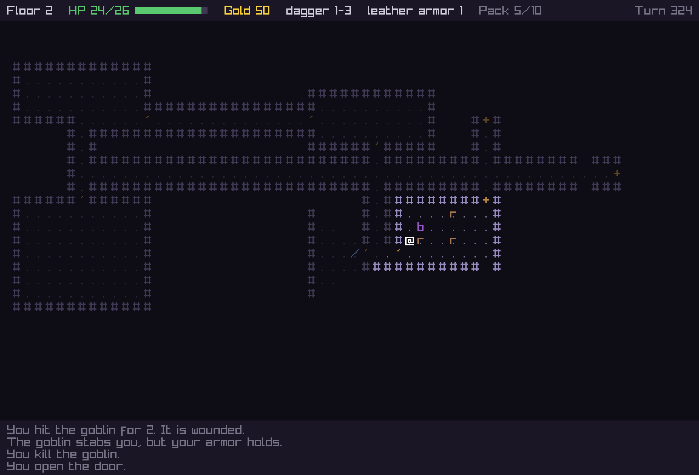

# Delve

A small roguelike in slang: seven floors of a dungeon made anew for every
game, the Amulet of Yendor at the bottom, and no way back up. The window,
the keyboard and the sound come from the raylib package
(`packages/raylib`); the dungeon, the sight, the monsters' minds and the
rules are slang with no window at all, so the game can play itself in the
tests.

```sh
make delve             # or: slang run examples/delve/main.slang
make delve-test        # sight, maps, rules and the autoplayer, without a window
```

Move with the arrow keys, `hjkl` and `yubn`, or the numpad. Walk into a
monster to attack it, into a door to open it. `.` or `5` waits, `g` picks
up, `>` descends, `i` opens the pack (a number uses an item), `?` shows
the help, `r` starts over after the end, escape quits.



## The game

There are no experience points and no classes: the dungeon itself is the
progression. Every floor down makes you a little hardier, and what you find
on the way (a sword, chain mail, a wand of lightning) is the rest. Monsters
sleep until you see them; then they come, and they know the way around
corners. Fighting in the open is how a game ends on floor two: a doorway or
a corridor lets only one of them at you at a time, because nothing moves or
strikes diagonally around the corner of a wall.

Monsters differ by what they do more than by their numbers:

| | | |
|---|---|---|
| `r` rat | comes in packs | |
| `b` bat | fast and erratic | four hits in ten miss it |
| `g` goblin | | |
| `a` goblin archer | shoots from six cells away | backs off when you close in |
| `o` ooze | slow | every hit that does not kill it splits it in two |
| `z` zombie | half your speed | hits hard, takes a beating |
| `G` ghost | walks through walls | |
| `T` troll | regenerates | |
| `W` warden | guards the amulet | |

Items: potions of healing (`!`), scrolls of teleport and of mapping (`?`),
wands of lightning (`/`, three bolts down a line), weapons (`)`) and armor
(`[`) that you wear if they are better than what you have, and gold (`$`),
which is the score. Now and then a wandering monster turns up out of
sight, so a floor is not a place to rest for long.

## How it is built

- `game/map.slang`: rooms placed at random, joined in order of their x
  by L-shaped corridors, a few more corridors for loops, doors where a
  corridor meets a room, the stairs in the room farthest (by moves) from
  the start. A floor is rejected unless every room is reachable.
- `game/fov.slang`: symmetric shadowcasting, after
  [Albert Ford](https://www.albertford.com/shadowcasting/). A floor cell
  sees you exactly when you see it, which is why sleeping monsters wake
  up when they appear on the screen and not before.
- `game/dijkstra.slang`: Dijkstra maps, after
  [Brian Walker](https://roguebasin.com/index.php/The_Incredible_Power_of_Dijkstra_Maps):
  one map from the player's cell serves every monster on the floor; a
  monster steps to the lowest neighbour. The archers flee on the same map
  multiplied by -1.2 and rescanned, which leads them around corners
  instead of into them.
- `game/world.slang`: the rules. An action of the player costs a turn;
  then every monster gains its speed in energy and acts once per 100.
- `game/bot.slang`: the autoplayer (`DELVE_AUTOPLAY=1`), exploring on a
  Dijkstra map whose goals are the edge of what it has seen, fighting
  what reaches it, backing into corridors when crowded, and taking the
  stairs once a floor is explored. The tests play six whole games with
  it.
- `main.slang`: drawing and input. The glyphs are raylib's default font,
  the sounds are square waves computed at start.

`DELVE_SEED=n` makes the same dungeon every run, `DELVE_FRAMES=n` quits
after n frames and `DELVE_SCREENSHOT=file` saves the last frame, for a
smoke test with a window: `DELVE_SEED=4 DELVE_AUTOPLAY=1 DELVE_FRAMES=300
slang run main.slang`.
