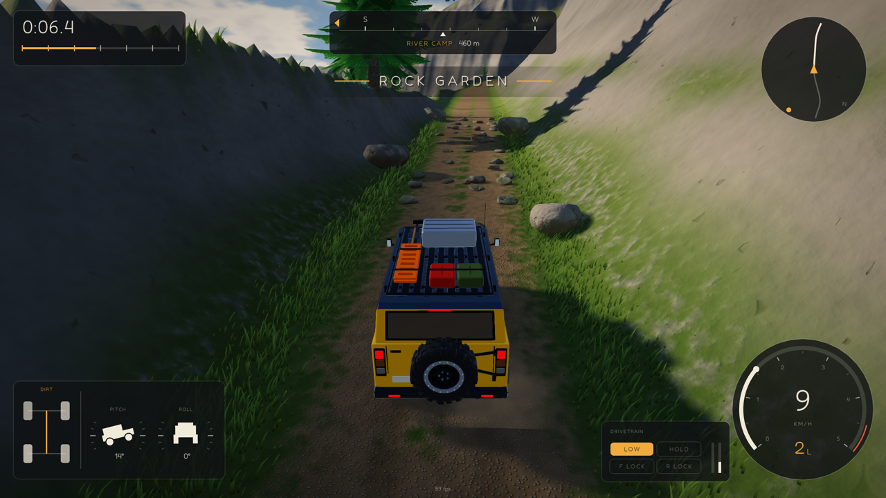

# Switchback

An off-road expedition through a valley made from a seed, in slang on
the raylib, Jolt and kernel packages. Trails lead from the meadow by the
river through fords, mud holes, washouts and moguls, past the lake, up
the hillsides in switchbacks, between rock walls, over ledges, through
rock gardens and fallen trees, to lookouts on the ridges, the lake's far
shore, the headwaters, and into the snow as high up the valley's
highest mountain as a track can go. They split and meet again; between them the land is
open to whoever leaves the track. The truck is yours to fit out.

There are two ways to play:

- **Explore** (the first): drive where you like. The valley's camps are
  found by coming to them; at a camp the truck is mended. A truck that
  breaks down is towed to the nearest camp found so far, and the place
  it broke down at must be found again. The map (`M`) shows the valley
  as relief or as a contour map, the trails, the camps you found, and
  markers you set; the way to the marker you choose is shown along the
  trails, on the map, on the small map and on the compass.
- **Summit Run**: the race. The clock runs from the trailhead to the
  summit, with checkpoints between; recoveries and wrecks cost time.

```sh
make switchback        # or: slang run examples/switchback/main.slang
make switchback-test   # the drivetrain, the truck, the land, the trails, the bot, exploring and a run, without a window
```



Sound is not in yet.

## Driving

`W` and `S` (or the arrows) drive and brake; `S` again at a standstill
reverses. `A` and `D` steer, `Space` is the hand brake. `Q` changes
between high and low range, `E` goes through the differential locks (open,
rear, rear and front; in low range the center is locked as well). `F`
hooks the winch to the nearest tree ahead (or to a ground anchor where
none stands) and pulls; `F` again lets go. Holding `R` puts the truck back
on the trail, for twenty seconds on the clock (exploring, it rights the
truck where it is). `M` opens the map while exploring: drag or `W`, `A`,
`S`, `D` to move it, the wheel or `Q`/`E` to zoom, a click to set a
marker or to follow one, a right click to take one away, `T` for the
contour map, `Space` back to the truck. `C` changes the camera, the mouse
looks around, `Esc` pauses.

A gamepad works too: right trigger drive, left trigger brake, left stick
steer, A hand brake, X low range, Y locks, d-pad up the winch, B (held)
back on the trail, Back the map, right stick look, Start pause.

The gearbox shifts by itself. On a slope the truck holds itself when you
let go of the pedals and rolls away without rolling back when you drive
on. Knocks do damage, shown in the HUD; a wreck costs forty-five seconds.

## The truck

One truck, built from code (`render/truck*.slang`), with a garage on the
title screen and in the pause menu: ten paints and a roof color, three
kinds of wheels, a stock bumper, a bull bar or a winch bumper, a basket
rack, an expedition load or a roof tent, a light bar, a snorkel, the spare
on the tailgate, rock sliders or side steps, mud flaps. What you choose is
kept in `~/.switchback/settings.json`, your best time of each valley in
`~/.switchback/best.json`, the camps you found and the markers you set
in `~/.switchback/explore.json`.

Underneath it is a Jolt body on four wheels (`game/car.slang`). Jolt finds
the ground under each wheel and carries the truck on springs that are part
of its solver, so the suspension settles in one swing and never rings;
each tire is held to the ground as a contact that does not slip until it
is asked for more than it has, which is why the truck stands still parked
across a slope and does not creep downhill on a slow traverse. Everything
else is slang:

- `game/drivetrain.slang`: an engine with a torque curve, a turbo's lag,
  an idle governor and a limiter; a clutch, five gears and a low range;
  center, front and rear differentials that can be locked. Engine and
  wheels are one system of equations solved once a step, so the engine's
  speed follows the road's while the clutch holds, the engine brakes the
  truck downhill, and a spinning wheel takes the revs up.
- `game/tires.slang` and `game/surfaces.slang`: what a tire can push and
  hold on rock, dirt, gravel, grass, sand, mud, snow, ice and a river's
  bed, by how it slips: loose ground gives its best only to a wheel that
  digs, and a sliding tire's grip goes against the slide.
- `game/winch.slang`: the line as a spring that the drum shortens.

`tool/lab.slang` is the test bench: the truck on tilted planes of every
surface, with numbers for what it does.

## The valley

Every seed is a valley (`game/terrain.slang`, its kernels in
`game/land.kernel`): a river winding through a lake, a floor of meadows,
foothills, benches and strata, mountains shaped by erosion, and one
mountain over the rest, its tops sharp horns in the snow. The heights are computed on every core
in a second or two.

The trails are nobody's drawing (`game/route.slang`): each is the
cheapest way over the land for something that cannot turn on the spot and
may not climb steeply, so it winds up slopes in switchbacks by itself.
The Summit Run goes first, five to seven kilometers up the highest
mountain, as high as it can climb on the mountain as it is (no step of
it steeper than a track may be: it is not dug in), not always to the
very top; then the
valley's other sights are found (the lake's far shore, the headwaters,
ground that stands out over what is around it), and each gets a trail
from wherever the trails there are come nearest, leaving them where they
run level; a few go on from their sight to meet the trails again
elsewhere, so that there are loops. Each is cut into the land as a track
with banks; they ford the river where it is given a shallow, cross a
ridge by a pass where they would otherwise be a trench, and get an
obstacle every few hundred meters that suits where it is: mud holes,
moguls, washouts, off-camber stretches, narrows cut through rock, rock
steps, rock gardens, deadfall. Where two trails meet, one leaves the
other at an angle, and the ground they share there is one piece: a plane
that climbs along each as it does, tilted across the other no more than
a few degrees, with the corners between the tracks rounded off; no
obstacle lies within fifty meters of it. A camp is a clearing beside the
track, with a tent, a fire and a pennant. The truck drives on the same triangles the picture shows,
half a meter to the sample.

Woods, bushes, boulders and logs are set on the land by kernels
(`game/plants.slang`), not on the track, and what stands near the truck is
solid. The grass is placed by the graphics card, lies down under the truck
and stays down where its wheels went; the wheels leave tracks in mud, snow
and sand (`render/tracks.slang`) and throw up dust, clods and spray
(`render/dust.slang`), and the truck gets muddy until a ford washes it.

`New valley` on the title screen takes the next seed.

## How it is laid out

- `game/`: the game without a window: the land, the trails, the truck, the
  world they are in, the rules of exploring (`explore.slang`) and of the
  Summit Run (`run.slang`), the way along the trails to a marker
  (`navigate.slang`), the bot that drives a trail in the tests
  (`bot.slang`).
- `render/`: the picture: the scene's passes (`scene.slang`: shadows, the
  land as a clipmap, plants, grass, water, dust, then bloom and grading),
  the HUD, the map (`map.slang`, its pictures in `map_picture.kernel`)
  and the menus.
- `tool/`: `lab` (the physics bench), `map` (a valley and its trails as
  a picture), `drive` (the bot drives a whole trail and reports), `view` (a camera on
  the bot), `showroom` (the truck), `arboretum` (the plants), `ui_preview`
  (the HUD and menus).
- `test/`: what `make switchback-test` runs.

For tests and pictures `main.slang` reads the environment
(`SWITCHBACK_SEED`, `SWITCHBACK_AUTOPLAY`, `SWITCHBACK_AT`,
`SWITCHBACK_SHOT` and others, listed at its top).
